<!-- ══════════════════════ HEADER ══════════════════════ -->

  

  

  
  
  
  

 

<!-- ══════════════════════ SOBRE MÍ ══════════════════════ -->
## 👋 Sobre mí

Me metí en este mundo de chico, jugando con **"Inspeccionar elemento"**: ponía mi nombre en los títulos de las webs que usaba, cambiaba descripciones y hasta sacaba los anuncios que me distraían del juego de turno. Hasta que un día recargué la página… y todo desapareció 😅.

Ahí entendí que quería aprender a hacer que los cambios **se queden**. Hoy soy **AI Product Engineer** en Montevideo: hago webs y sistemas para negocios de Uruguay que resuelven algo que se hace a mano, y construyo con agentes de IA que corren todos los días en producción.

  
   
  🖥️ Donde trabajo

 

<!-- ══════════════════════ DESTACADO ══════════════════════ -->
## ⭐ Destacado: MiSplash

  <a href="https://misplash.com/negocios">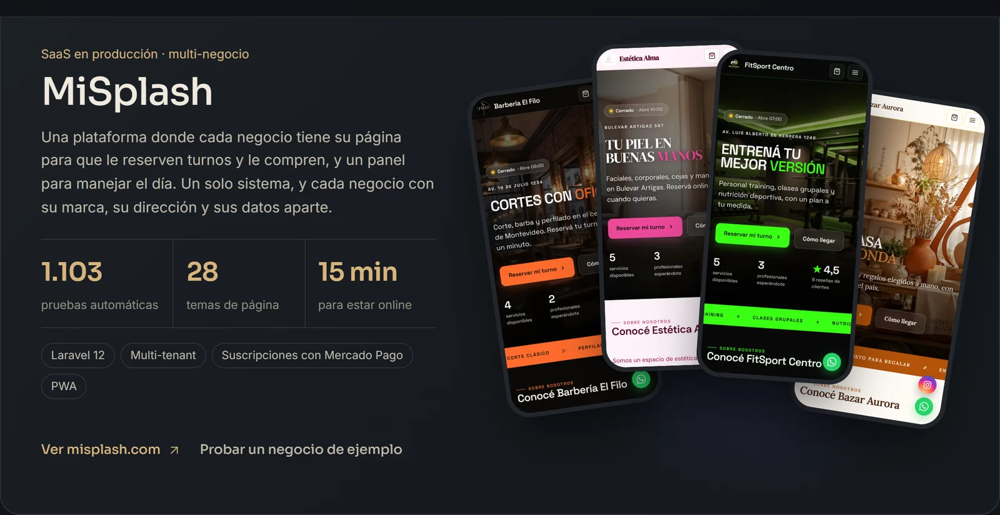</a>

 

<!-- ══════════════════════ EN PRODUCCIÓN ══════════════════════ -->
## 🚀 En producción

Todos los casos en <a href="https://lucashermida.com/webs/">lucashermida.com/webs</a>.

<table>
  <tr>
    <td align="center" width="50%" valign="top">
      <a href="https://queridasaturna.com">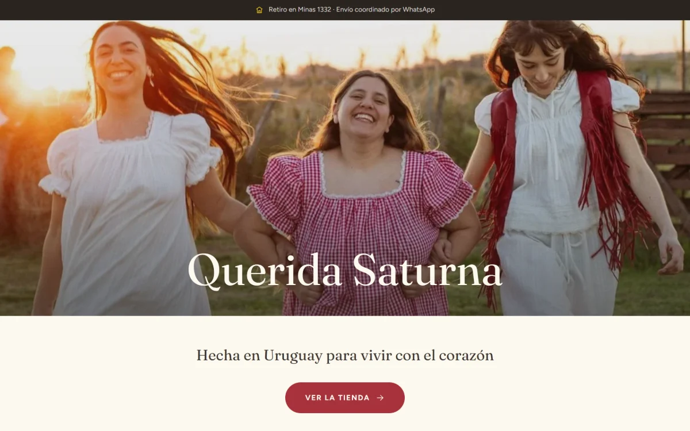</a>
       <strong>Saturna</strong> Tienda de ropa
       <a href="https://queridasaturna.com">Ver el sitio</a> · <a href="https://lucashermida.com/casos/saturna">Cómo se hizo</a>
    </td>
    <td align="center" width="50%" valign="top">
      <a href="https://adrianamieres.com.uy">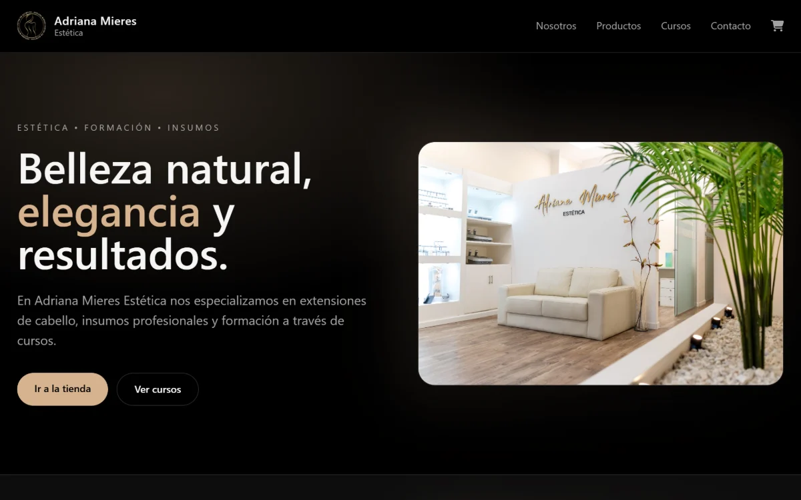</a>
       <strong>Adriana Mieres</strong> Medicina estética
       <a href="https://adrianamieres.com.uy">Ver el sitio</a> · <a href="https://lucashermida.com/casos/adriana-mieres">Cómo se hizo</a>
    </td>
  </tr>
  <tr>
    <td align="center" width="50%" valign="top">
      <a href="https://eliceche.com">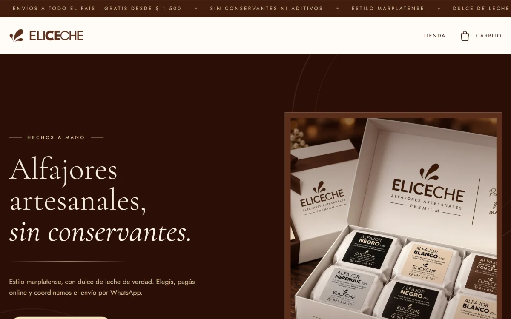</a>
       <strong>Eliceche</strong> Alfajores artesanales
       <a href="https://eliceche.com">Ver el sitio</a> · <a href="https://lucashermida.com/casos/eliceche">Cómo se hizo</a>
    </td>
    <td align="center" width="50%" valign="top">
      <a href="https://psicnataliaaren.com">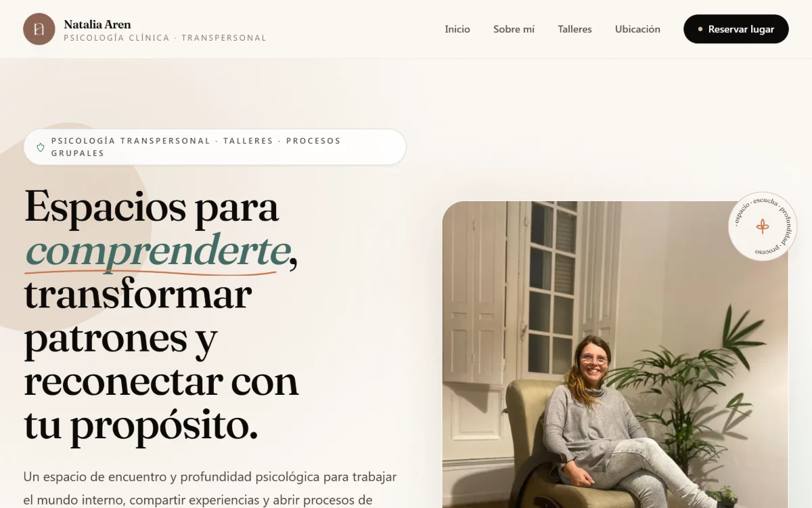</a>
       <strong>Natalia Arén</strong> Psicología
       <a href="https://psicnataliaaren.com">Ver el sitio</a> · <a href="https://lucashermida.com/casos/natalia-aren">Cómo se hizo</a>
    </td>
  </tr>
  <tr>
    <td align="center" width="50%" valign="top">
      <a href="https://onheelsuy.com">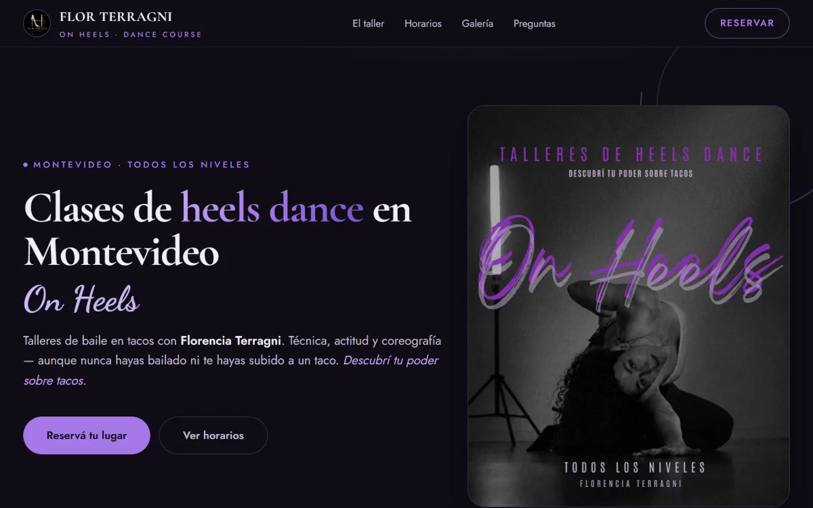</a>
       <strong>On Heels</strong> Escuela de heels dance
       <a href="https://onheelsuy.com">Ver el sitio</a> · <a href="https://lucashermida.com/casos/on-heels">Cómo se hizo</a>
    </td>
    <td align="center" width="50%" valign="top">
      <a href="https://cerrajeriabrian.com">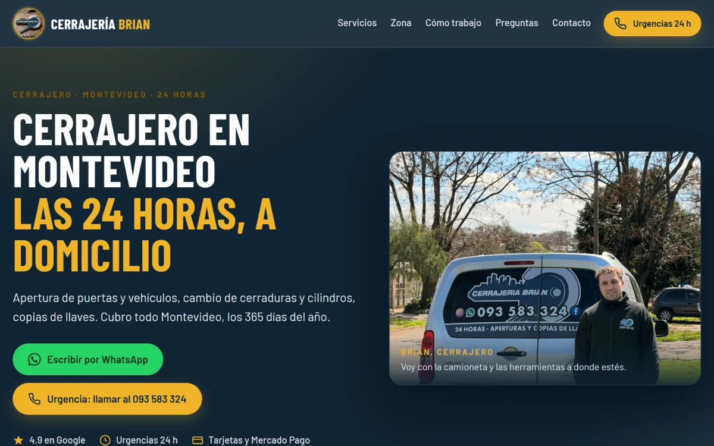</a>
       <strong>Cerrajería Brian</strong> Cerrajería 24 h
       <a href="https://cerrajeriabrian.com">Ver el sitio</a> · <a href="https://lucashermida.com/casos/cerrajeria-brian">Cómo se hizo</a>
    </td>
  </tr>
  <tr>
    <td align="center" width="50%" valign="top">
      <a href="https://gracielalempert.uy">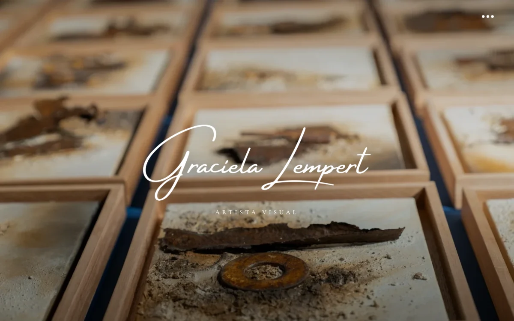</a>
       <strong>Graciela Lempert</strong> Artista visual
       <a href="https://gracielalempert.uy">gracielalempert.uy</a> · <a href="https://lucashermida.com/casos/graciela-lempert">Cómo se hizo</a>
    </td>
    <td align="center" width="50%" valign="top">
      <a href="https://laletralibros.com">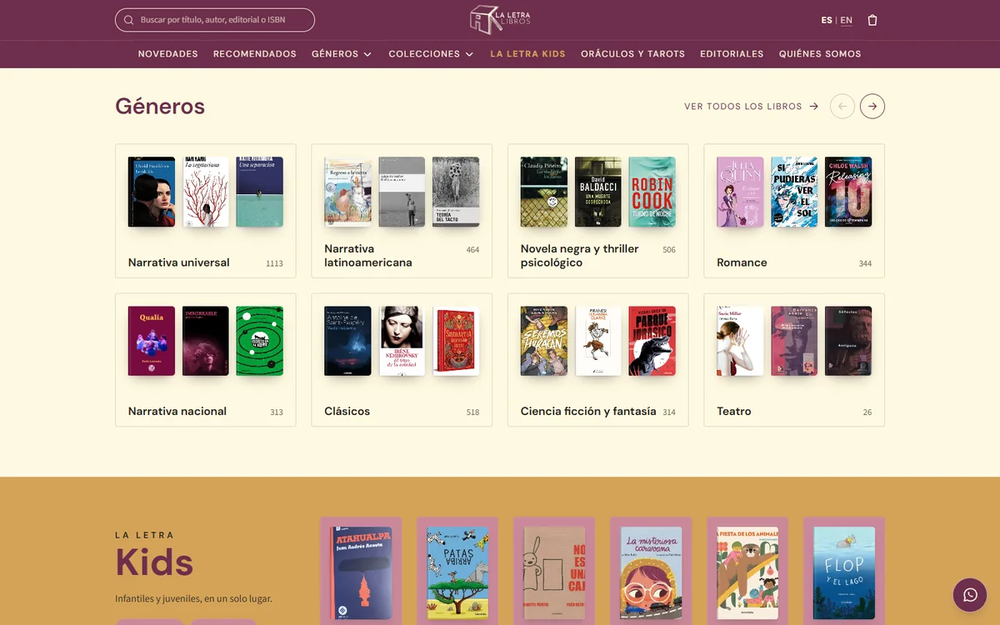</a>
       <strong>La Letra Libros</strong> Librería en Piriápolis
       <a href="https://laletralibros.com">laletralibros.com</a>
    </td>
  </tr>
  <tr>
    <td align="center" width="50%" valign="top">
      <a href="https://lucashermida.com/casos/janet-guzman">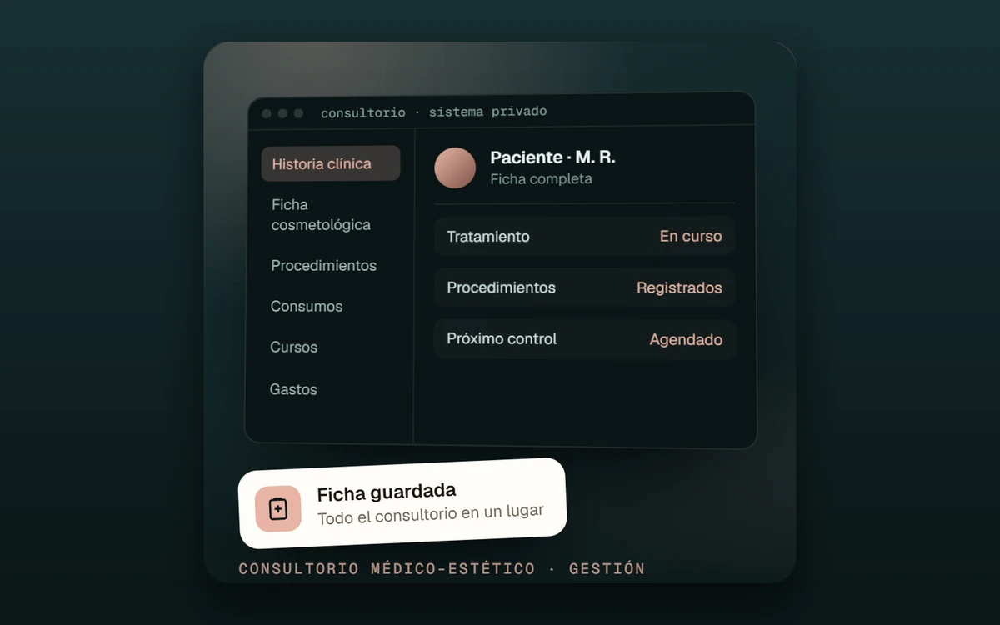</a>
       <strong>Dra. Janet Guzmán</strong> Consultorio médico-estético
       <a href="https://lucashermida.com/casos/janet-guzman">Ver el caso</a>
    </td>
    <td align="center" width="50%" valign="top">
      <a href="https://residencialmonarca.com">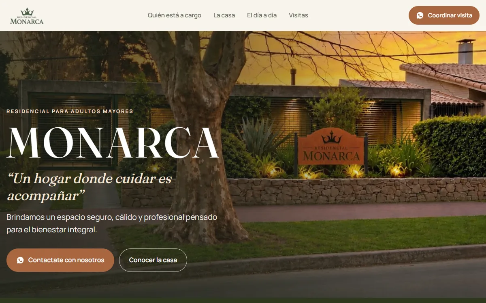</a>
       <strong>Residencial Monarca</strong> Residencial para adultos mayores
       <a href="https://residencialmonarca.com">residencialmonarca.com</a>
    </td>
  </tr>
</table>

 

<!-- ══════════════════════ STACK ══════════════════════ -->
## 🧰 Con qué está hecho

  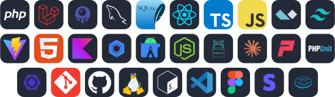

 

<!-- ══════════════════════ CÓDIGO ABIERTO ══════════════════════ -->
## 🔓 Código abierto: demos y experimentos

<table>
  <tr>
    <td align="center" width="50%" valign="top">
      <a href="https://lucashermida.com/e-commerce/inicio">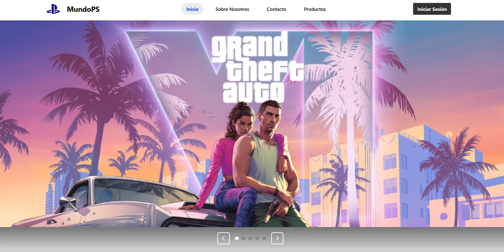</a>
       <strong>🎮 MundoPS, e-commerce</strong>
         
        Tienda hecha a mano, sin frameworks, con checkout de Stripe y panel admin.
          
    </td>
    <td align="center" width="50%" valign="top">
      <a href="https://lucashermida.com/presencia-flash/">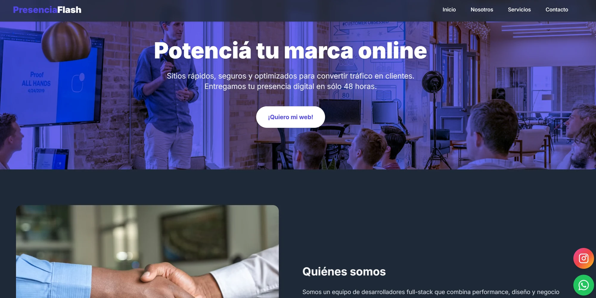</a>
       <strong>⚡ Presencia Flash, landing</strong>
         
        Landing liviana, sin dependencias externas.
         
    </td>
  </tr>
  <tr>
    <td align="center" width="50%" valign="top">
      <a href="https://github.com/LucasHermida1/asistente-financiero">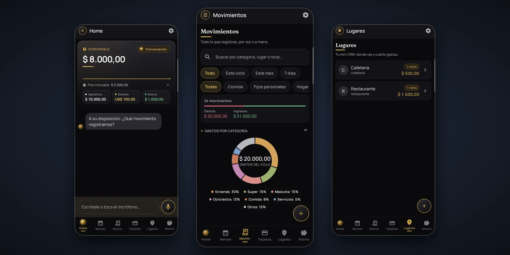</a>
       <strong>🎙️ Asistente Financiero por voz</strong>
         
        App Android a la que le hablás y lleva tus gastos al día.
        
    </td>
    <td align="center" width="50%" valign="top">
      <a href="https://github.com/LucasHermida1/tenant-platform">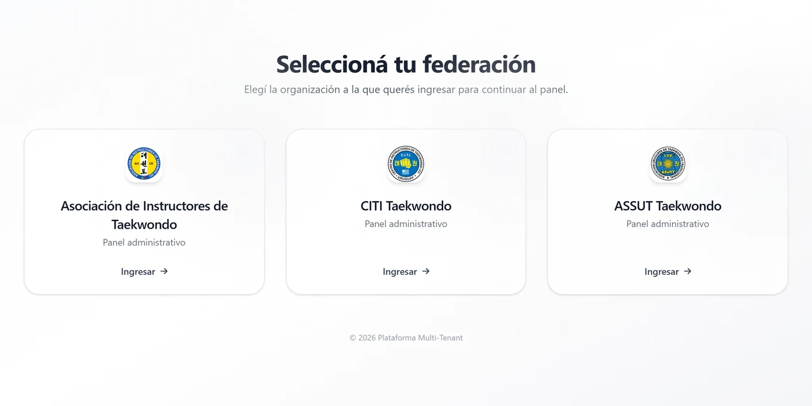</a>
       <strong>🥋 Tenant Platform</strong>
         
        Una plataforma para varias federaciones, cada una con sus datos aparte.
        
    </td>
  </tr>
</table>

 

<!-- ══════════════════════ CONTACTO ══════════════════════ -->
## 📬 ¿Hablamos?

  Contame qué hace tu negocio a mano hoy. Si tiene solución te digo cómo, y si no, también.
    
  
  
  

  

